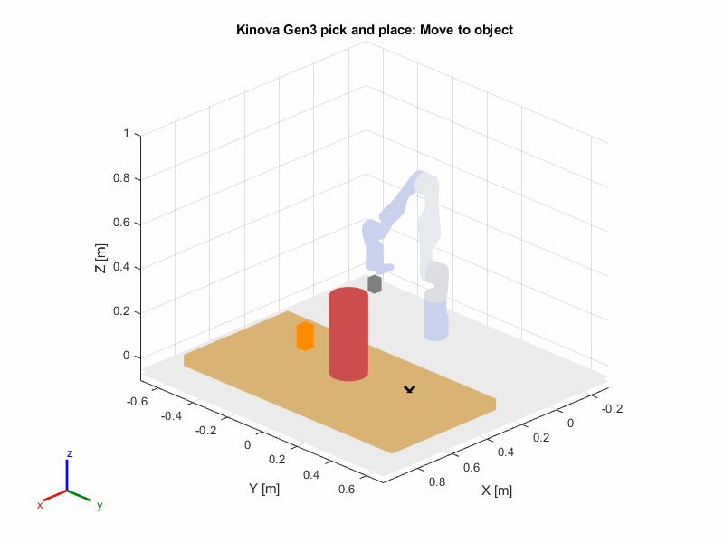

# Kinova Gen3 Pick-and-Place with Collision-Free Motion Planning

MATLAB simulation of a 7-DOF **Kinova Gen3** robot arm that picks up an object from a table, carries it around an obstacle and places it at a user-defined position. The motion is planned with **inverse kinematics** and the sampling-based planner **RRT**, then converted into a smooth, time-parameterized trajectory and checked for collisions sample by sample.



Originally developed for the course *Robot Modeling and Control* during a study abroad semester at San Diego State University (fall 2025), later reworked and extended.

## Features

- **Complete pick-and-place cycle:** ready pose, approach, grasp, lift, transport, place, retreat and return
- **Collision-free motion planning** with RRT in joint space, avoiding the table and the obstacle with a 3 cm safety margin
- **Carried object included in planning:** after grasping, the object is attached to the gripper as an extra collision body
- **Smooth trajectories:** RRT paths are shortened and sampled with trapezoidal velocity profiles
- **Straight-line approach and retreat** in Cartesian space, solved with inverse kinematics
- **Collision-free key poses:** the 7-DOF arm can reach a pose with different elbow positions; several IK solutions are compared and the closest collision-free one is used
- **Workspace validation:** targets outside the table, on the obstacle or out of reach are rejected with a clear message
- **Trajectory verification:** collision check of every sample, minimum clearance to the obstacle, maximum joint step
- **Own DH forward kinematics**, verified against the Robotics System Toolbox

## How it works

| Phase | Motion | Method |
|---|---|---|
| 1 | Ready pose to above the object | RRT in joint space |
| 2 | Descend to grasp | Straight line, inverse kinematics |
| 3 | Lift the object | Straight line, inverse kinematics |
| 4 | Transport to above the target | RRT with the carried object as collision body |
| 5 | Descend and place | Straight line, inverse kinematics |
| 6 | Retreat | Straight line, inverse kinematics |
| 7 | Return to ready pose | RRT in joint space |

**Why this split?** RRT finds collision-free paths in the 7-dimensional joint space, but its paths are random and do not keep the tool orientation. Close to the table the gripper has to move vertically with a fixed orientation, so these short motions are planned as straight lines in Cartesian space instead.

**From path to trajectory:** RRT only returns a few waypoints. The path is first shortened, then every segment between two waypoints is sampled with a trapezoidal velocity profile, so the robot accelerates and decelerates smoothly. The planner validates the segments between the shortened waypoints, so the sampled trajectory stays collision-free.

**Kinematics:** `kinematics/verifyDHModel.m` implements forward kinematics from a DH table as a product of link transforms and compares it with a rigid body tree built by the toolbox for 1000 random configurations.

## Getting started

**Requirements:** MATLAB R2024a or newer with the Robotics System Toolbox.

1. Open the project folder in MATLAB.
2. Run `main.m`. It plans the motion, prints the trajectory check and plays the animation.
3. Change `cfg.targetXY` in `main.m` to place the object somewhere else on the table.

Set `cfg.exportMedia = false` to skip writing the GIF and video to `media/`.

## Repository structure

```
main.m                    Entry point: configuration, planning, verification, animation
src/
  buildKinovaWithGripper.m  Kinova Gen3 model with a simple gripper
  createScene.m             Table, obstacle and object
  planPickAndPlace.m        Planning of the complete cycle
  planJointMotion.m         RRT, path shortening and trapezoidal velocity profiles
  planLine.m                Straight-line Cartesian motion via inverse kinematics
  solveIK.m                 Inverse kinematics with reachability check
  findCollisionFreeIK.m     Chooses a collision-free arm configuration for key poses
  checkTrajectory.m         Collision and smoothness check of the trajectory
  animatePickAndPlace.m     Animation and GIF/MP4 export
kinematics/
  verifyDHModel.m           Own DH forward kinematics vs. toolbox
  dhTransform.m, forwardKinematicsDH.m, buildRobotFromDH.m
media/                    Generated animation
```

## Limitations

- The gripper is a rigid box. Grasping is modelled kinematically: the object is attached to the gripper once it is in position, without contact forces or physics.
- Self-collision checks are disabled in the planner because the collision meshes of adjacent links overlap in the Kinova model.
- RRT is randomized. A fixed random seed makes runs reproducible; other seeds produce different, but also collision-free paths.

## Possible extensions

- Optimal planners such as RRT* or a trajectory optimisation for shorter paths
- A two-finger gripper with an opening and closing motion
- Dynamics: joint torques along the trajectory from the toolbox's inverse dynamics
